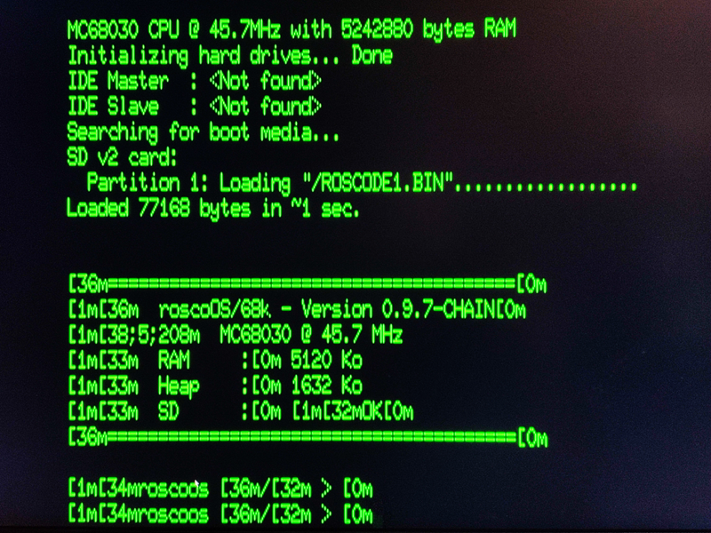

# roscoOS/68k

A small multitasking operating system for the **ROSCO_M68K** (MC68000 / MC68010),
written in C and 68k assembly.

## Features

- **Preemptive multitasking** driven by the 100 Hz DUART tick, plus a cooperative scheduler
- Full task lifecycle: create, exit, `kill <tid>|all`; stacks returned to the heap, slots recycled
- Shell: history, aliases, I/O redirection (`>` `>>`), `;` chaining, background execution
- **FatFs on SD card**: read **and** write
- CPU model and clock read from the firmware SDB — no hard-coded values
- Runs on a **stock Classic 2.42 firmware**: **no ROM modification required**
- Native programs: BASIC V4.0 (`mbasic_rosco5m.bin`), mini-edit, hello, guess, busy, test programs

## Requirements

| | |
|---|---|
| RAM | **4 MB minimum** — the kernel is linked at 0x400000 |
| CPU | MC68000 or MC68010 (validated at 10, 12 and 16 MHz) |
| Firmware | ROSCO_M68K **Classic 2.42, stock** — do not modify the ROMs |
| Storage | SD card, partition 1 (FAT) |

## Quick start

1. Download the latest release.
2. **Back up your SD card.**
3. Copy `ROSCODE1.bin` to the root of partition 1 (keep a copy of your previous boot file).
4. Copy the programs you want (`mbasic_rosco5m.bin`, `mini-edit5m.bin`, …) to the root.
5. Reboot. The banner shows your real CPU and speed, e.g. `MC68000 @ 16.0 MHz`.

Then in the shell: `help`, `ver`, `mem`, `ps`.

## Testing

See [docs/TESTING.md](docs/TESTING.md) for the full procedure and expected outputs.
Short version: `ver`, `ps`, `mem`, then `run cpuinfo.bin` and `run irqframe.bin`.

## Known issues

- A slow or cheap SD card can fail a large copy with `Erreur: ecriture incomplete`
  **and truncate the destination file to 0 bytes**. Reads are unaffected.
- 1 MB boards are not supported yet (heap layout).
- 68020/68030 exception-frame support is implemented but not yet tested on real hardware.

## Repository contents

- `ROSCODE1.bin` — the OS kernel (boot file for the SD card)
- `mbasic_rosco5m.bin` — BASIC V4.0 interpreter
- `mini-edit5m.bin`, `hello.bin`, `guess.bin`, `busy5m.bin` — sample programs
- Test programs: `cpuinfo.bin`, `irqframe.bin`, `sleepirq.bin`, `sleepprobe.bin`, `test4_irq5m.bin`
- `CHANGELOG.md`, `LICENSE`

The source code is not distributed.

## License

MIT — see [LICENSE](LICENSE).

---

# roscoOS/68k (français)

Petit système d'exploitation multitâche pour **ROSCO_M68K** (MC68000 / MC68010),
écrit en C et en assembleur 68k.

## Fonctionnalités

- **Multitâche préemptif** piloté par le tick 100 Hz du DUART, plus un ordonnanceur coopératif
- Cycle de vie complet des tâches : création, sortie, `kill <tid>|all` ; piles rendues au heap, slots recyclés
- Shell : historique, alias, redirections (`>` `>>`), chaînage `;`, exécution en arrière-plan
- **FatFs sur carte SD** : lecture **et** écriture
- Modèle de CPU et fréquence lus dans le SDB du firmware — aucune valeur codée en dur
- Fonctionne sur un firmware **Classic 2.42 d'origine** : **aucune modification des ROMs n'est nécessaire**
- Programmes natifs : BASIC V4.0 (`mbasic_rosco5m.bin`), mini-edit, hello, guess, busy, programmes de test

## Configuration requise

| | |
|---|---|
| RAM | **4 Mo minimum** — le noyau est linké à 0x400000 |
| CPU | MC68000 ou MC68010 (validés à 10, 12 et 16 MHz) |
| Firmware | ROSCO_M68K **Classic 2.42, d'origine** — ne pas modifier les ROMs |
| Stockage | carte SD, partition 1 (FAT) |

## Démarrage rapide

1. Télécharger la dernière release.
2. **Sauvegarder sa carte SD.**
3. Copier `ROSCODE1.bin` à la racine de la partition 1 (en gardant une copie de l'ancien).
4. Copier les programmes souhaités (`mbasic_rosco5m.bin`, `mini-edit5m.bin`, …).
5. Redémarrer. La bannière affiche le vrai CPU et sa fréquence, ex. `MC68000 @ 16.0 MHz`.

Puis dans le shell : `help`, `ver`, `mem`, `ps`.

## Tests

Voir [docs/TESTING.md](docs/TESTING.md). Version courte : `ver`, `ps`, `mem`,
puis `run cpuinfo.bin` et `run irqframe.bin`.

## Problèmes connus

- Une carte SD lente ou bon marché peut faire échouer une grosse copie avec
  `Erreur: ecriture incomplete` et **vider le fichier de destination**.
  La lecture n'est pas affectée.
- Les cartes 1 Mo ne sont pas encore supportées (plan mémoire).
- Le support des frames d'exception 68020/68030 est implémenté mais pas encore testé sur matériel réel.

## Licence

MIT — voir [LICENSE](LICENSE).

Voir [CHANGELOG.md](CHANGELOG.md) pour l'historique des versions.

## Validated on 68030 (emulated)

roscoOS 0.9.7-CHAIN has been validated on an emulated MC68030 with 5 MB RAM
(rosco-emulator, firmware 2.42 stock):

- MC68030 @ 45.7 MHz (Musashi calibration ~2x), 5,242,880 bytes RAM
- SD v2 card, partition 1: `/ROSCODE1.BIN` (77,168 bytes)
- roscoOS: RAM 5120 Ko, Heap 1632 Ko, SD OK
- `irqframe`: SDB `0x6006FA94`, model=3 → 8-byte exception frame, OK
